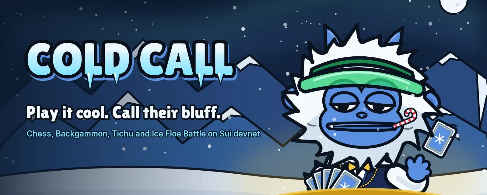
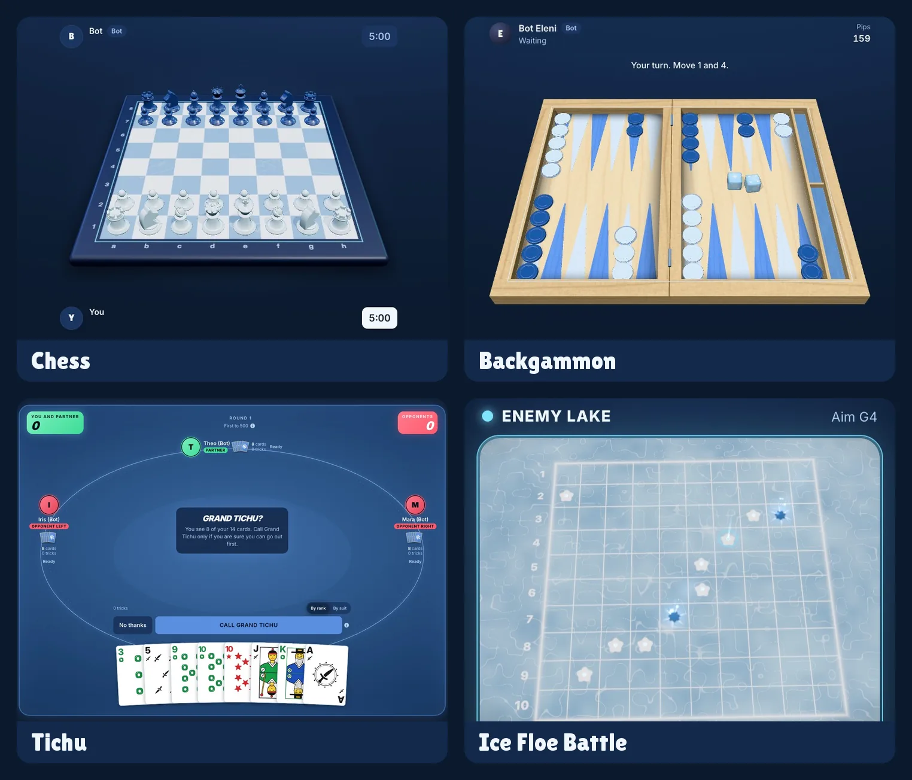
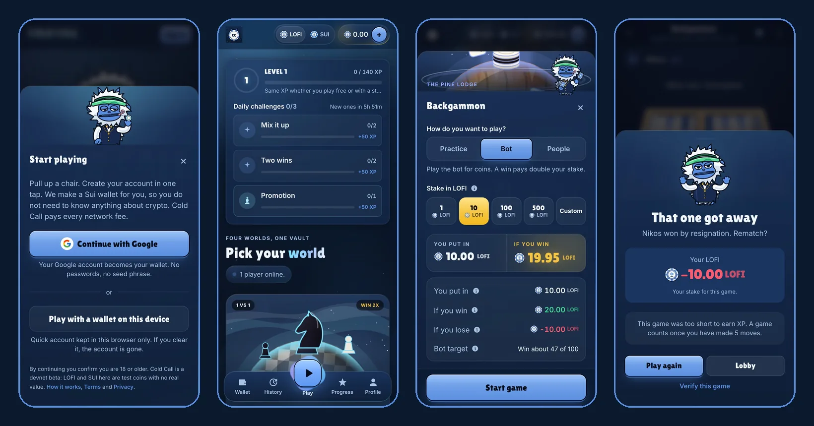
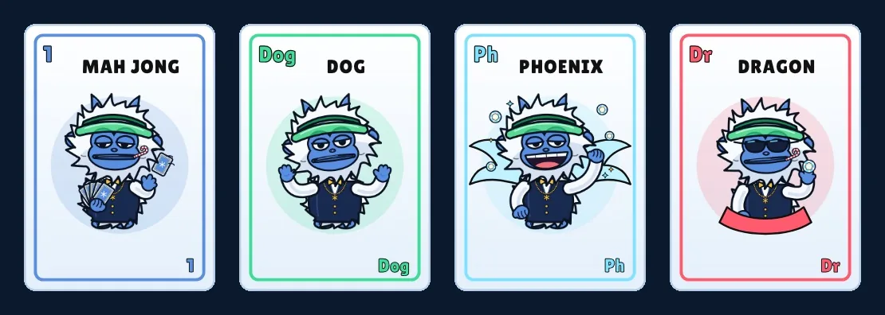
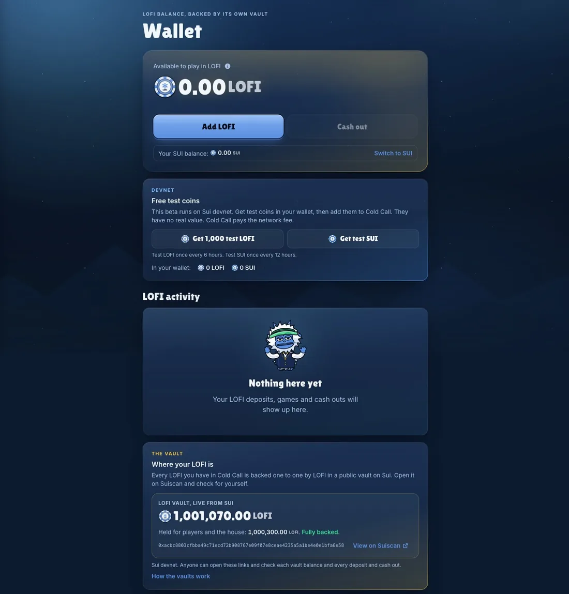
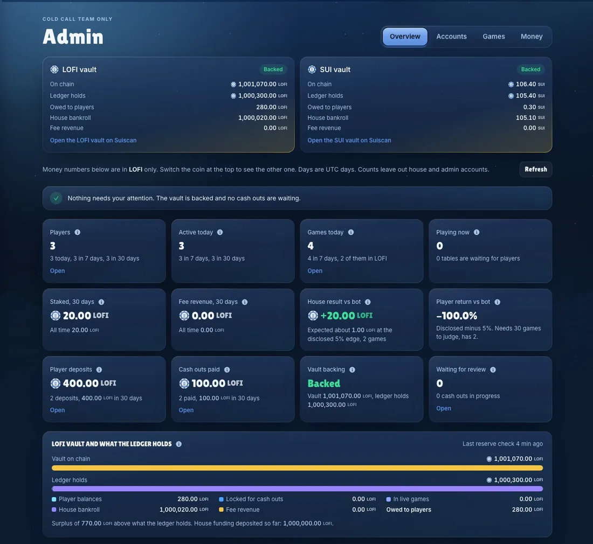
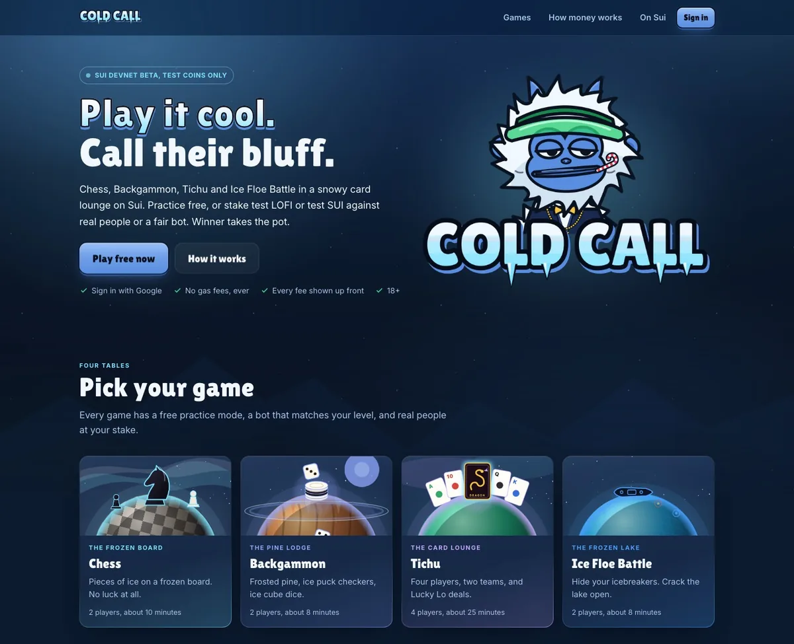
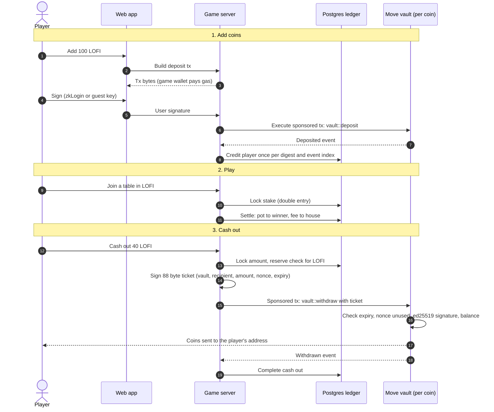
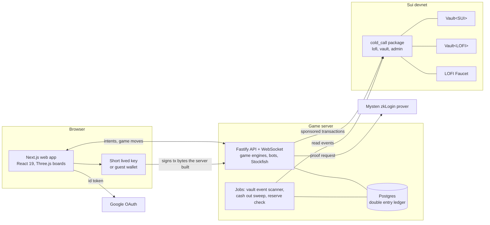
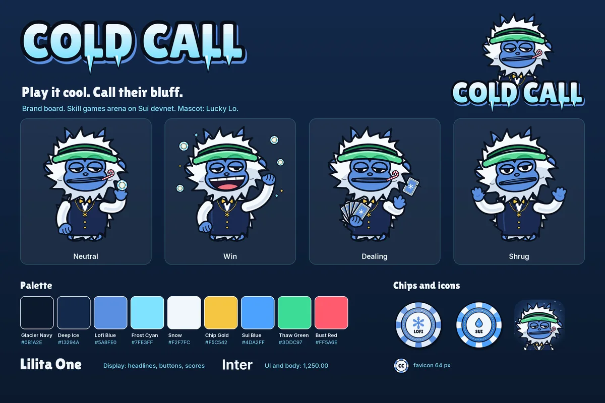

<div align="center">



# COLD CALL

**Play it cool. Call their bluff.**

A skill games arena on Sui. Chess, Backgammon, Tichu and Ice Floe Battle, played for test LOFI or test SUI, with real Move vaults behind every coin.

[](https://suiscan.xyz/devnet/object/0x1c3c732c1bc3c6dafb9695e277473e7c0f4241147dd8510e4ae418995af0ed43)
[](move/README.md)
[](#sign-in-and-gas)
[](#sign-in-and-gas)
<br />
[](https://nextjs.org)
[](docs/DATABASE.md)
[](#credits)

### [Play now](https://coldcall.45-81-6-214.sslip.io) &nbsp;&nbsp;|&nbsp;&nbsp; [Move package on Suiscan](https://suiscan.xyz/devnet/object/0x1c3c732c1bc3c6dafb9695e277473e7c0f4241147dd8510e4ae418995af0ed43) &nbsp;&nbsp;|&nbsp;&nbsp; Demo video: [watch on YouTube (3:23)](https://youtu.be/SwkUPz8EQVY)

</div>

> [!NOTE]
> Everything runs on **Sui devnet**. LOFI and SUI here are **test coins with no money value**. Grab them free inside the app.

---

## What it is

COLD CALL is a snowy card lounge carved into a mountain, run by **Lucky Lo**, a smug yeti dealer who has seen every bluff. You sit down at one of four tables, pick how you want to play, and the money side runs on Sui.

- **Four skill games.** Chess, Backgammon, Tichu (2 v 2 cards) and Ice Floe Battle (battleship on a frozen lake).
- **Three ways to play.** Free practice, against a bot (a win pays 2x, with a disclosed 5% house edge), or against people (winner takes the pot, 5% fee).
- **Two coins, never mixed.** Test LOFI and SUI are separate balances. Every table, fee, limit and reserve check names its coin.
- **Real vaults.** Coins you add go into a public Move `Vault<T>`. Cash outs are server signed tickets that the contract checks before it pays.
- **No crypto homework.** Sign in with Google through zkLogin (no seed phrase) or a guest wallet. The server pays every network fee.

The games run fast on our server. The money runs on Sui, where anyone can check it.

## Screenshots

<div align="center">



<sub>Four tables. Every board, piece, card and sound is drawn in code for COLD CALL.</sub>

<br /><br />



<sub>On a phone: sign in with Google or a guest wallet, pick a world, see every number before you play, and get an honest result.</sub>

<br /><br />



<sub>Lucky Lo plays every Tichu special card.</sub>

<br /><br />

<table>
<tr>
<td width="50%" valign="top"><br /><sub><b>Wallet.</b> Your balance per coin, one tap test coins, and the live vault balance with a Suiscan link.</sub></td>
<td width="50%" valign="top"><br /><sub><b>Admin.</b> Vault on chain versus what the ledger holds, per coin, plus players, games, fees and the house result against the disclosed edge.</sub></td>
</tr>
</table>



<sub>The landing page.</sub>

</div>

## Features

### Games

| Game | The table | Players |
|---|---|---|
| **Chess** | Pieces of ice on a frozen board, 3D | 1 v 1 |
| **Backgammon** | Frosted pine board, ice puck checkers, ice cube dice, 3D | 1 v 1 |
| **Tichu** | The lounge deck, ice blue felt, Lucky Lo on the special cards | 2 v 2 |
| **Ice Floe Battle** | Hide your icebreakers on a frozen lake, crack the ice open | 1 v 1 |

### Modes

| Mode | How it pays | Fee |
|---|---|---|
| **Practice** | Free, no coin | none |
| **Against the bot** | Win pays 2x the stake, loss loses the stake, chess draw returns 90% | none, the edge is built into the bot (5%, published) |
| **Against people** | Equal stakes form the pot, winner (or winning Tichu team) takes it | 5% of the stake, shown before you join |

Quick match only pairs players of the same game, coin and stake.

### Two coins

| Coin | What it is | Free test coins |
|---|---|---|
| **LOFI** | `LOFI (devnet test)`, a test coin minted by this package, 9 decimals | On chain faucet: 1,000 LOFI per claim, once every 6 hours (enforced by the contract) |
| **SUI** | Native devnet SUI | 0.5 SUI from the game wallet, once every 12 hours |

Balances are held per coin and **never converted**. No swap, no exchange rate, no shared pool. Each coin has its own vault, house bankroll, tables and matchmaking.

### Fair play

- **No fake numbers.** No invented "players online", no fake wins feed, no pressure timers.
- **Published edge.** One flat 5% house edge against the bot at every stake, in both coins. Chess uses Stockfish 19 tuned so that expected return is minus 5%. The other games target a 47.5% win chance. The bot only ever looks at your skill rating for that game, never your balance or losses.
- **Provably fair randomness.** The server commits to `sha256(seed)` before the game, players add client seeds, and the verify page replays every roll, shuffle and move in the browser after the seed is revealed.
- **Responsible play limits.** 18+ at sign up. Daily and weekly deposit and loss limits, set per coin (lowering applies now, raising waits 24 hours). Breaks of 24 hours, 7 days or 30 days, a 6 month pause, and an hourly session reminder. Cashing out always works.

Full public rules: [`docs/HOW_IT_WORKS.md`](docs/HOW_IT_WORKS.md).

## On Sui

| Piece | How COLD CALL uses it |
|---|---|
| **Move vaults** | One shared `Vault<SUI>` and one shared `Vault<LOFI>`. Every coin in the app is backed one to one by a public vault. |
| **Signed cash out tickets** | The server signs an 88 byte ed25519 ticket. The contract verifies it, checks expiry against the on chain clock, and burns the nonce. |
| **LOFI test coin** | Created with `sui::coin_registry`. The `TreasuryCap` is locked inside a shared `Faucet` with a per address cooldown. |
| **zkLogin** | Google sign in becomes a Sui address. No seed phrase, no extension. |
| **Sponsored transactions** | The user signs, the game wallet pays gas. Deposits, cash outs and faucet claims cost the player nothing. |
| **Events** | Deposits are credited only from `vault::Deposited` events read from the chain, once per digest and event index. |

### Live objects (devnet)

| Object | Suiscan |
|---|---|
| Package `cold_call` | [`0x1c3c...ed43`](https://suiscan.xyz/devnet/object/0x1c3c732c1bc3c6dafb9695e277473e7c0f4241147dd8510e4ae418995af0ed43) |
| `Vault<SUI>` | [`0xf876...b382`](https://suiscan.xyz/devnet/object/0xf876736621841037e5737b6926cead1fbd08b72255c9fc0d87b003fd88a3b382) |
| `Vault<LOFI>` | [`0xacbc...6e58`](https://suiscan.xyz/devnet/object/0xacbc8803cfbba49c71ecd72b908767e09f07e8ceae4235a5a1be4e0e1bfa6e58) |
| LOFI `Faucet` | [`0xe272...502c`](https://suiscan.xyz/devnet/object/0xe2723c6d654a7de53c4462de1c75e75d6c2314b12abd3d12948291e84e42502c) |
| LOFI `Currency` | [`0x4f93...1b86`](https://suiscan.xyz/devnet/object/0x4f939f42d2ece0b62c0cc0cfeaa0ec7d0f06e541b73cb70c81523a684c1d1b86) |

All public ids live in [`cold_call.config.json`](cold_call.config.json). Devnet is wiped about every two weeks, so the ids change after each republish. The config file is always the source of truth.

## How money moves

Add, play, cash out. The chain holds the coins, the ledger tracks who owns what, and the contract has the final word on every payout.



### Architecture



The server is the only authority on game state and money. The browser sends intents and signs transactions the server built. The server only sponsors transactions it built itself, that call into the `cold_call` package and never touch `tx.gas`.

<a id="sign-in-and-gas"></a>
### Sign in and gas

- **Google (zkLogin).** Your Google account becomes your Sui wallet. The address comes from your Google account id and a salt the server keeps stable. Signing happens in your browser with a short lived key, and the proof comes from the Mysten zkLogin prover through our server.
- **Guest.** A wallet key kept in this browser only.
- **Sponsored gas.** The player is the sender, the game wallet is the gas owner, both sign the same bytes. The player never needs SUI just to move SUI.

## Move package

Source: [`move/sources`](move/sources). Full reference with every function and event: [`move/README.md`](move/README.md). 30 unit tests, including a byte for byte check of the ticket layout against a vector made with the TypeScript SDK.

| Module | What it does |
|---|---|
| `cold_call::admin` | `AdminCap`, minted to the publisher in `init`. |
| `cold_call::lofi` | The `LOFI (devnet test)` coin, 9 decimals, and the shared `Faucet` that holds its `TreasuryCap`. |
| `cold_call::vault` | The shared `Vault<T>`: deposits, ticket checked withdrawals, house funding, pause. |

### Entry functions

| Function | Who | What |
|---|---|---|
| `lofi::claim(faucet, clock)` | anyone | Mints 1,000 LOFI to the sender, once per 6 hour cooldown |
| `lofi::admin_mint`, `set_amount`, `set_cooldown` | `AdminCap` | Faucet admin |
| `vault::create<T>(cap, server_pubkey)` | `AdminCap` | Shares a new vault, pubkey must be 32 bytes |
| `vault::deposit<T>(vault, coin)` | anyone | Adds coins, emits `Deposited` |
| `vault::withdraw<T>(vault, amount, nonce, expiry_ms, sig, clock)` | ticket holder | Pays the sender if the server signed ticket checks out |
| `vault::fund<T>(vault, coin)` | anyone | House bankroll, not a user deposit |
| `vault::set_server_pubkey<T>`, `set_paused<T>`, `admin_withdraw<T>` | `AdminCap` | Rotate the signer, pause deposits and cash outs, move house funds and fees |
| `vault::ticket_message(vault, recipient, amount, nonce, expiry_ms)` | read | Returns the exact 88 bytes the server signs |

`withdraw` checks, in order: not paused, amount above 0, clock before `expiry_ms`, nonce unused, signature is 64 bytes, `ed25519_verify(sig, server_pubkey, msg)`, enough balance. Then it burns the nonce and sends the coins.

### Withdrawal ticket layout

Raw ed25519 signature over exactly 88 bytes. No intent prefix, no hashing.

| Offset | Size | Field | Encoding |
|---|---|---|---|
| 0 | 32 | vault object id | address bytes |
| 32 | 32 | recipient | address bytes, must equal the tx sender |
| 64 | 8 | amount | u64 little endian, base units |
| 72 | 8 | nonce | u64 little endian, single use per vault |
| 80 | 8 | expiry_ms | u64 little endian, valid while on chain clock < expiry_ms |

### Abort codes

| Module | Code | Name | Meaning |
|---|---|---|---|
| vault | 1 | `EPaused` | Vault paused (deposit, withdraw) |
| vault | 2 | `EZeroAmount` | Amount is 0 |
| vault | 3 | `EExpired` | Clock at or past `expiry_ms` |
| vault | 4 | `ENonceUsed` | Ticket nonce already used (replay) |
| vault | 5 | `EBadSignature` | Signature invalid for this vault, sender, amount, nonce and expiry |
| vault | 6 | `EInsufficientFunds` | Vault balance lower than amount |
| vault | 7 | `EBadPubkey` | Server pubkey not 32 bytes |
| vault | 8 | `EBadSignatureLength` | Signature not 64 bytes |
| lofi | 100 | `ECooldown` | Claimed again before the cooldown ended |
| lofi | 101 | `EZeroAmount` | `set_amount(0)` or `admin_mint(0)` |

## Security and money safety

- **Backed one to one.** Every coin in the ledger sits in the vault of that coin. A reserve check runs every 5 minutes per coin and compares the vault on chain with everything the ledger holds (players, live games, house, fees).
- **Chain first credits.** A deposit counts only after the `Deposited` event is read from the chain, keyed by digest and event index, so it can never be credited twice. A background scanner is the backup path.
- **Tickets the contract checks.** Cash outs need the server's ed25519 signature over vault, recipient, amount, nonce and expiry. Nonces are single use per vault, tickets expire after 10 minutes, and the recipient must be the sender.
- **No lost cash outs.** An expired ticket's amount returns to the player only after the chain confirms its nonce was never used.
- **Daily caps and review.** Up to 20,000 LOFI and 50 SUI cashed out per player per day. Larger cash outs wait for a manual review.
- **Tight sponsorship.** The server only pays gas for transactions it built, calling only the `cold_call` package, never touching `tx.gas`. A sponsored tx that tries to split the sponsor's gas coin is rejected by the node.
- **Integers only.** Money is integers in hundredths of a coin, converted to base units with BigInt. Every external input is validated with Zod.
- **Admin brakes.** `set_paused` stops deposits and cash outs per vault while balances stay safe. Keys never live in the repo.

## Try it as a judge

1. Open **[coldcall.45-81-6-214.sslip.io](https://coldcall.45-81-6-214.sslip.io)** and tap **Play free now**.
2. Sign in with **Continue with Google** (zkLogin) or **Play with a wallet on this device**.
3. Play a **Practice** game of anything. No coins needed.
4. Go to **Wallet** and tap **Get 1,000 test LOFI** and **Get test SUI**. No gas needed, the server sponsors it.
5. Tap **Add LOFI** to deposit into `Vault<LOFI>`. Open the vault on Suiscan from the wallet page and see the `Deposited` event.
6. Pick a game, choose **Bot**, pick a LOFI stake and read the summary: what you put in, what you win, what you lose, the bot target.
7. Finish the game, then open **Verify this game** to replay it from the revealed seed.
8. Switch the coin at the top to **SUI** and see a fully separate balance and table list.
9. **Cash out** some LOFI. The withdrawal ticket is checked by `vault::withdraw` and the coins land in your Sui address.

## Run locally

Needs Node 20+, pnpm 10, Postgres 17 and a published `cold_call` package (or the public `cold_call.config.json` in this repo).

```bash
brew services start postgresql@17
createdb coldcall_devnet
pnpm install
cp apps/server/.env.example apps/server/.env   # fill in CC_GAME_KEY, GOOGLE_CLIENT_ID, ZK_SALT_SECRET, COLD_CALL_CONFIG
./scripts/dev.sh                               # API on :4000 (migrates on boot), web on :3000
```

`GOOGLE_CLIENT_ID` can stay empty: then only the guest wallet sign in is offered. Full variable list, background jobs and admin tools: [`docs/RUNBOOK.md`](docs/RUNBOOK.md).

### Tests

```bash
pnpm test                                    # money rules, game engines, server tests (needs local Postgres)
pnpm e2e                                     # live API flow on devnet with a fresh guest wallet
node apps/web/e2e/flow.mjs ./shots           # same flow in a real browser, with screenshots
cd move && sui move test                     # 30 Move unit tests
```

### Publish the Move package

```bash
cd move/scripts
npm ci
./publish.sh     # tests, publish, create both vaults, fund the house, write cold_call.config.json
node e2e.mjs     # live devnet proof: faucet, deposits, signed cash outs, replay, expiry, wrong signer, pause
```

### Deploy

`scripts/deploy.sh --setup` prepares a Linux host once: a system user, a Postgres database, two systemd units (API and web) and a Caddy site with HTTPS. After that, `scripts/deploy.sh` ships the committed HEAD, builds next to the live release, switches over, runs health checks and rolls back on failure. Secrets stay in a config folder on the server and never travel with the code.

## Repo layout

```
coldcall/
├── apps/
│   ├── web/          Next.js app: lobby, 3D boards, wallet, verify, admin
│   └── server/       Fastify API + WebSocket: rooms, bots, ledger, vault jobs, zkLogin, sponsorship
├── packages/
│   ├── games/        Chess, Backgammon, Tichu, Ice Floe Battle engines, bots and seeded RNG
│   └── shared/       Money rules, protocol types, game metadata
├── move/             cold_call Move package: sources, tests, publish and e2e scripts
├── brand/            Brand guide, fonts, Lucky Lo and logo drawn in code
├── docs/             How it works, runbook, database schema, assets and licences
├── scripts/          dev.sh, deploy.sh, screenshot helper
└── cold_call.config.json   Public chain ids (package, vaults, faucet)
```

## Tech stack

| Layer | Tools |
|---|---|
| Chain | Sui devnet, Move 2024, `@mysten/sui` 2.39.1 over gRPC |
| Sign in | zkLogin with Google OAuth and the Mysten prover, guest Ed25519 wallets |
| Web | Next.js 15, React 19, Tailwind CSS 4, Three.js |
| Server | Node, Fastify 5, WebSocket rooms, Zod, Stockfish 19 |
| Data | Postgres 17, double entry ledger, `pg` |
| Tests | Vitest, Playwright, Move unit tests, live devnet e2e scripts |
| Hosting | systemd, Caddy |

## Credits

<div align="center">

</div>

- Built for **CLAY**, the Lofi the Yeti hackathon on Sui. Lucky Lo is an original character made for COLD CALL in the flat cartoon style of the Lofi universe.
- All art (wordmark, mascot, chips, boards, pieces, cards, 3D scenes) and all sounds are drawn or generated in code for this project. Details in [`docs/ASSETS.md`](docs/ASSETS.md) and [`brand/BRAND_COLDCALL.md`](brand/BRAND_COLDCALL.md).
- Fonts: [Lilita One](https://fonts.google.com/specimen/Lilita+One) and [Inter](https://fonts.google.com/specimen/Inter), SIL Open Font License 1.1.
- Chess engine: [Stockfish](https://stockfishchess.org) 19 (GPL v3, run on the server). Move rules: chess.js (BSD 2 Clause).
- Sui, Move and zkLogin by [Mysten Labs](https://sui.io).

<div align="center">

**Everything here runs on Sui devnet. LOFI and SUI in COLD CALL are test coins with no money value. 18+.**

<sub>Play it cool. Call their bluff.</sub>

</div>
